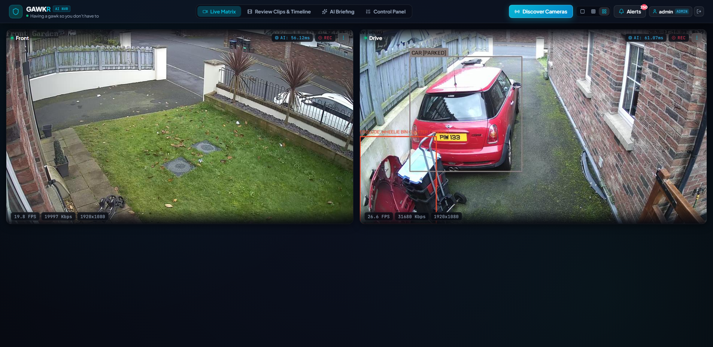
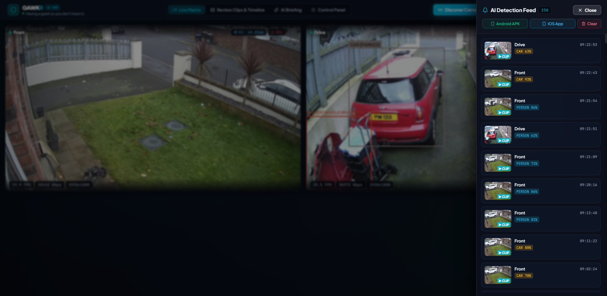
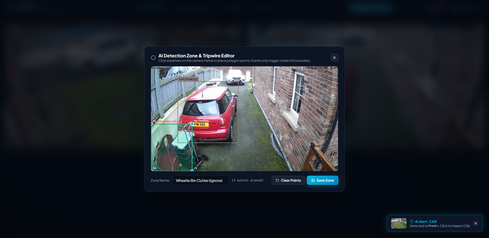
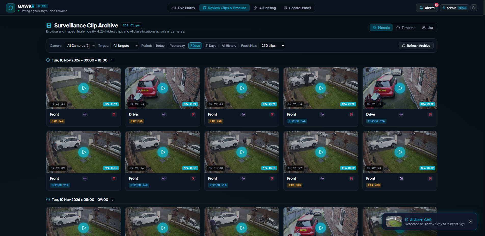
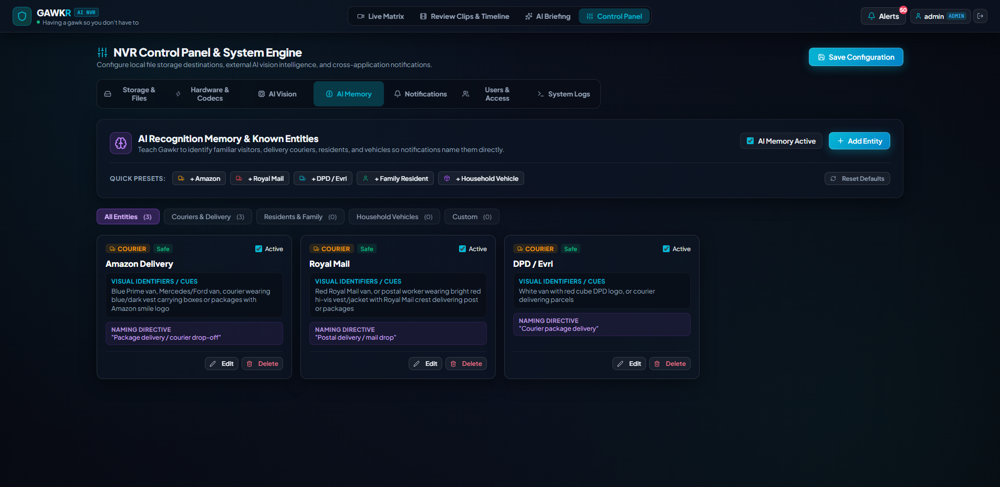
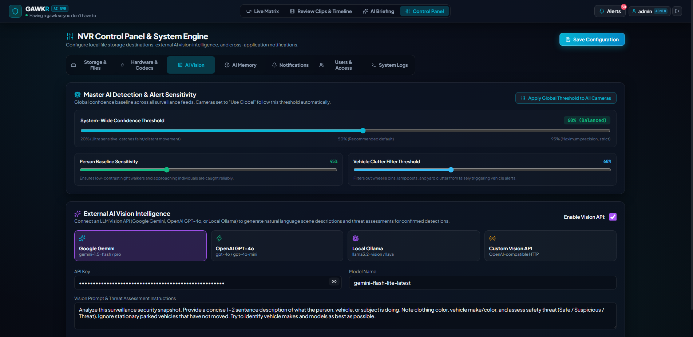
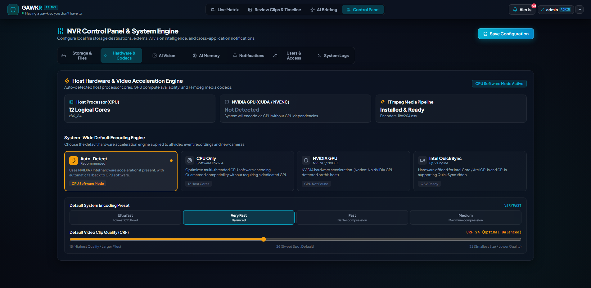
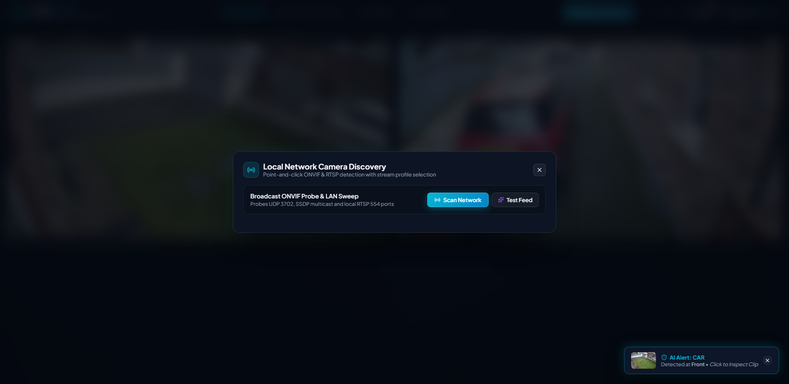

# Gawkr AI-NVR Server

> *"Having a gawk so you don't have to."*

A high-speed, hardware-accelerated local Network Video Recorder (NVR) with real-time AI object identification, spatial motion tracking (no endless alerts for stationary project cars!), multimodal Gemini Vision event descriptions, Telegram notifications, and a sleek glassmorphic dashboard.

---

## 📸 Interface Tour & Screenshots

### 1. Live Surveillance Matrix
Real-time dual 1080p stream matrix with hardware acceleration, live telemetry chips (FPS, bitrate, resolution, neural inference latency), spatial motion tracking (`[PARKED]` vs `[MOVING]`), and active zone overlays.



---

### 2. Real-Time AI Detection Feed & Alerts Drawer
Sliding glassmorphic notification drawer featuring chronological detection events, confidence percentages, instant MP4 clip playback, and mobile app download shortcuts.



---

### 3. Interactive Detection Zones & Tripwires
Point-and-click polygon editor directly over live video feeds to draw custom inclusion zones, tripwires, or exclusion zones (e.g. ignoring wheelie bins and swaying foliage).



---

### 4. Surveillance Clip Archive & Timeline
High-fidelity H.264 MP4 clip review with hourly grouping, target filters (people, vehicles, pets), multi-day retention ranges, and 1-click *"Add to AI Memory"* reference capture.



---

### 5. AI Recognition Memory & Known Entities
Teach Gawkr to recognize familiar visitors, delivery couriers (Amazon, Royal Mail, DPD / Evri), family residents, and household vehicles so push notifications and AI Vision identify them by name.



---

### 6. Master Sensitivity & External AI Vision Intelligence
Global confidence sliders, night-time person baseline sensitivity, vehicle clutter filters, and multimodal LLM integration (Google Gemini, OpenAI GPT-4o, Local Ollama).



---

### 7. Hardware Acceleration & Codec Engine
Host processor auto-detection, GPU offload engine selection (NVIDIA NVDEC/NVENC, Intel QuickSync QSV, multi-threaded CPU `libx264`), encoding presets, and CRF video quality controls.



---

### 8. Triple-Protocol Network Camera Discovery
Point-and-click camera discovery across ONVIF WS-Discovery (UDP 3702), SSDP multicast, and LAN RTSP port sweeps to find IP cameras with zero RTSP URL guesswork.



---

## 🚀 Key Highlights

1. **Intelligent Spatial Motion & Anti-Repetition**:
   - **Stationary vs Moving Tracking**: Knows the difference between an actively driving car and a parked project car in the driveway. Parked cars are marked `[PARKED]` and never spam alerts unless they move ($\ge 10\%$ displacement).
   - **Multimodal AI Descriptions (Google Gemini / OpenAI / Ollama)**: Delivers 1-2 sentence human-like summaries of actual events with false-alarm suppression for empty scenes.

2. **Point-and-Click Network Discovery**:
   - Automated triple-protocol scan (ONVIF WS-Discovery UDP 3702, SSDP multicast, and LAN RTSP port sweep).
   - Enter credentials $\rightarrow$ Click **"Verify & Probe Profiles"** $\rightarrow$ Auto-populates Main & Sub stream RTSP URLs.
   - 1-Click **"Add to Matrix"** with zero manual URL guesswork.

3. **Hardware Acceleration & Codec Flexibility**:
   - Support for NVIDIA NVDEC/NVENC, Intel QuickSync (QSV), and multi-threaded CPU (`libx264`) decoding/encoding.
   - Zero-delay instant playback: MP4 clips recorded with pre-roll buffer and faststart for immediate browser playback.

4. **Glassmorphism UI & Interactive Management**:
   - Frosted acrylic panels (`backdrop-filter: blur(28px)`), obsidian dark theme, and live telemetry (FPS, Bitrate, Resolution, Decoder, AI latency).
   - Context menus, interactive zone/tripwire polygon editor, live detection overlays, and isolated notification feed drawer.

5. **Instant Outbound Alerts**:
   - Real-time Telegram alerts with photo snapshot captions, threat assessments, and instant plain-text fallbacks.
   - Support for Discord webhooks, Slack, Pushover, and Home Assistant MQTT auto-discovery.

---

## 🌐 Quick Access

* **URL**: [http://localhost:8000](http://localhost:8000)
* **Default Admin Login**: `admin` / `admin123`
* **Default Viewer Login**: `viewer` / `viewer123`

---

## 🛠️ Project Structure

```
gawkr/
├── backend/
│   ├── app/
│   │   ├── main.py                     # FastAPI entrypoint, WebSockets & static server
│   │   ├── auth.py                     # RBAC JWT authentication & stream tickets
│   │   ├── ai_vision.py                # Multimodal LLM vision & anti-repetition rules
│   │   ├── discovery.py                # ONVIF WS-Discovery, SSDP & LAN RTSP probe
│   │   ├── inference.py                # Object detection & zone polygon filtering
│   │   ├── stream_worker.py            # Dual-stream worker, NVDEC & spatial tracking
│   │   ├── camera_manager.py           # In-memory & SQLite camera management
│   │   ├── storage.py                  # SQLite WAL database & snapshot repository
│   │   ├── notification_dispatchers.py # Telegram, Discord, Slack, Pushover webhooks
│   │   └── mqtt_client.py              # Home Assistant MQTT auto-discovery
│   └── requirements.txt
├── frontend/                           # React 18 + Vite Glassmorphic Dashboard
│   ├── src/
│   │   ├── components/                 # CameraGrid, CameraTile, EventDrawer, etc.
│   │   └── api/                        # REST & WebSocket API clients
│   └── package.json
├── docs/
│   └── screenshots/                    # High-resolution application screenshots
└── docker-compose.yml
```
