# 👁️ Gawkr AI-NVR Server

<div align="center">

> *"Having a gawk so you don't have to."*

A state-of-the-art, hardware-accelerated local Network Video Recorder (NVR) with real-time AI object detection, spatial motion tracking, multimodal AI event descriptions, interactive tripwires, natural language incident search, active perimeter deterrence, multi-platform notifications, enterprise defense, and an ultra-responsive obsidian glass-morphic dashboard.

[](https://fastapi.tiangolo.com)
[](https://react.dev)
[](https://vitejs.dev)
[](https://docs.ultralytics.com)
[](https://ffmpeg.org)
[](https://www.home-assistant.io)
[](https://www.sqlite.org/fts5.html)
[](LICENSE)

</div>

---

## 🌟 Highlights at a Glance

* **⚡ Ultra-Low Latency Dual-Stream Pipeline**: Sub-second RTSP decoding with GPU acceleration (NVIDIA NVDEC/NVENC, Intel QuickSync QSV, multi-threaded CPU). Low-bandwidth sub-streams for continuous neural inference + crystal-clear 1080p/4K main streams for event recordings.
* **🧠 Spatial Motion & Parked vs Moving Tracking**: Zero alert fatigue. Distinguishes between an actively moving vehicle and a stationary parked project car. Parked entities are marked `[PARKED]` and never spam notifications unless displaced by $\ge 10\%$.
* **🔍 "Ask Gawkr" Natural Language Search**: Query surveillance history with plain English (e.g., *"red delivery van with parcels between 10am and 12pm"*, *"person loitering near front porch"*) powered by multimodal AI indexing and SQLite FTS5.
* **🗺️ Multi-Camera Subject Journeys**: Incident stitching tracks person or vehicle trajectories across multiple cameras (`Front Door` $\rightarrow$ `Driveway` $\rightarrow$ `Back Garden`) into a single chronological timeline.
* **🚨 Smart Perimeter Active Deterrence**: Automated Home Assistant MQTT triggers. Flash floodlights, sound sirens, or trigger PTZ presets when an unrecognized target lingers in exclusion zones.
* **🛡️ Enterprise Security & Auto-Defense**: Built-in TOTP Two-Factor Authentication (2FA), device fingerprinting, Cloudflare edge IP extraction (`CF-Connecting-IP`), and automated brute-force IP lockout.
* **📱 Native Android Companion App**: Live surveillance matrix, real-time push notification badges, and actionable lockscreen alerts with instant H.264 playback.

---

## 📸 Visual Showcase & Tour

### 1. Live Surveillance Matrix & Telemetry
High-density multi-camera surveillance view rendered with an obsidian glassmorphic UI (`backdrop-filter: blur(28px)`). Features live telemetry chips (real-time FPS, bitrate, stream resolution, decoder engine, and AI inference latency) alongside spatial status badges (`[PARKED]` vs `[MOVING]`).

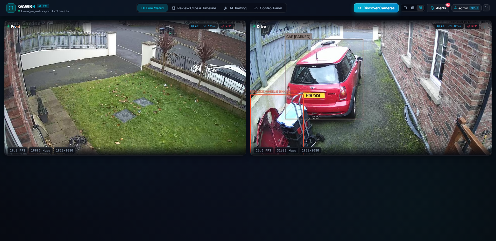

---

### 2. Real-Time AI Detection Feed & Alerts Drawer
A sliding acrylic drawer displaying real-time neural detections with confidence scores, object bounding classes, quick-playback MP4 triggers, and 1-click APK download for mobile monitoring.

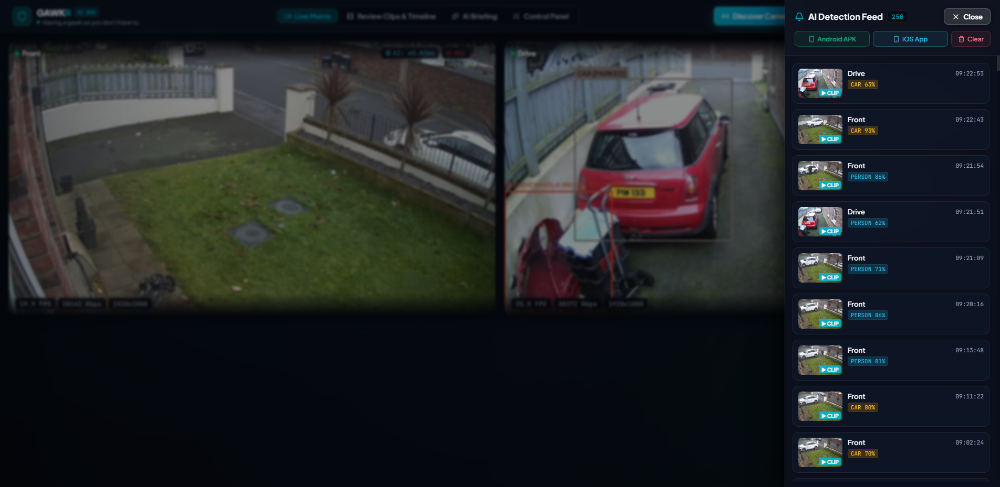

---

### 3. AI Event Playback & Clip Inspection
Deep dive into any flagged detection event. Inspect high-resolution snapshots or stream zero-latency H.264 MP4 recordings with custom speed controls (0.5x, 1x, 2x), multimodal AI threat summaries, and 1-click export to local storage or AI Recognition Memory.

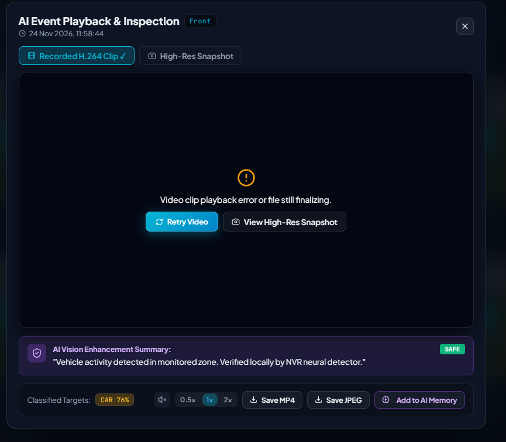

---

### 4. Interactive Detection Zones & Polygon Tripwires
Point-and-click polygon editor overlaid directly onto live video feeds. Draw custom inclusion zones, directional tripwires, and exclusion masks to ignore tree branches, swaying foliage, or public sidewalks.

<p align="center">
  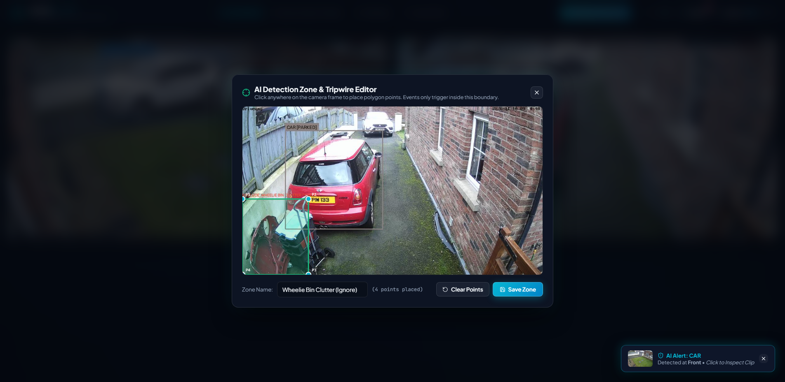
  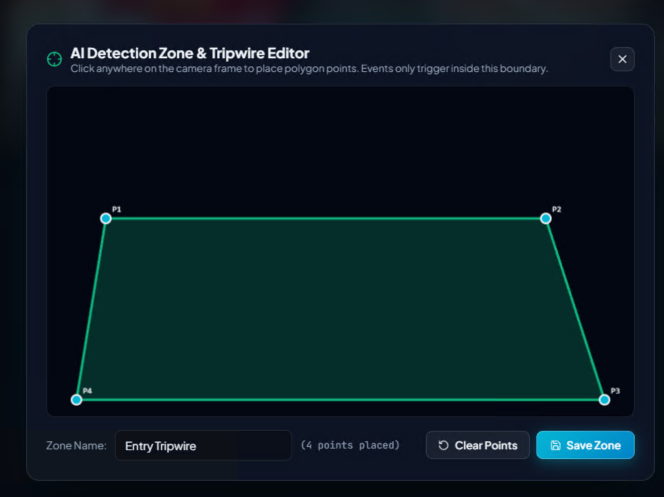
</p>

---

### 5. Surveillance Clip Archive & Timeline
Browse historical footage grouped by hour and day. Apply multi-attribute filters (People, Vehicles, Pets, Delivery couriers), jump directly to high-probability timestamps, and download forensic-grade MP4 clips with pre-roll buffers.

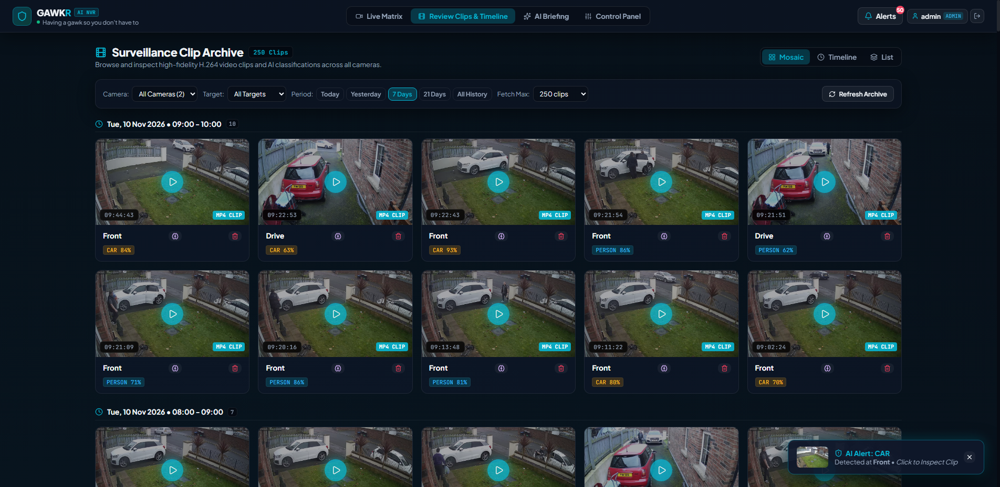

---

### 6. AI Recognition Memory & Known Entities
Teach Gawkr to recognize frequent visitors, couriers (Amazon, Royal Mail, DPD, Evri), family members, and authorized vehicles. AI Vision models cross-reference verified entity snapshots to label known faces and vehicles in real-time alert notifications.

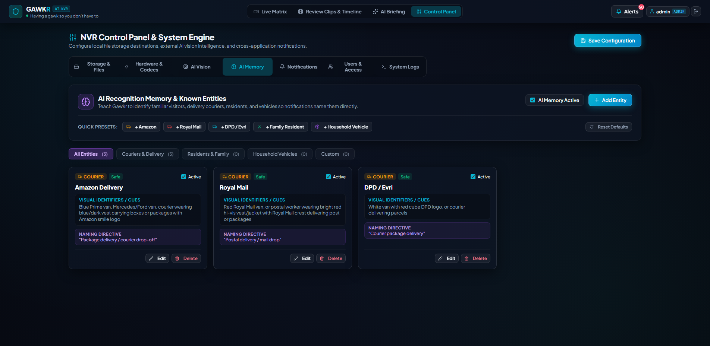

---

### 7. External AI Vision Intelligence & Sensitivity Control
Fine-tune global confidence thresholds, night-time person sensitivity baselines, and stationary clutter filters. Configure external multimodal LLM engines (Google Gemini, OpenAI GPT-4o, or self-hosted local Ollama) for human-like event summaries and contextual threat scores.

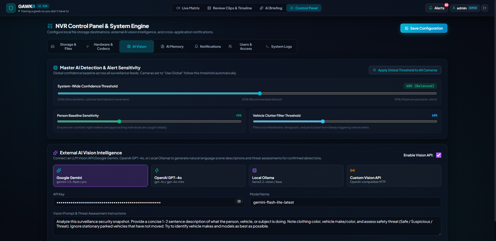

---

### 8. Hardware Acceleration & Codec Engine
Host hardware auto-detection with runtime GPU offload engine selection. Choose between NVIDIA NVDEC/NVENC, Intel QuickSync (QSV), or multi-threaded CPU (`libx264`). Configure CRF quality metrics, encoding presets (`ultrafast` to `veryslow`), and custom audio transcoding.

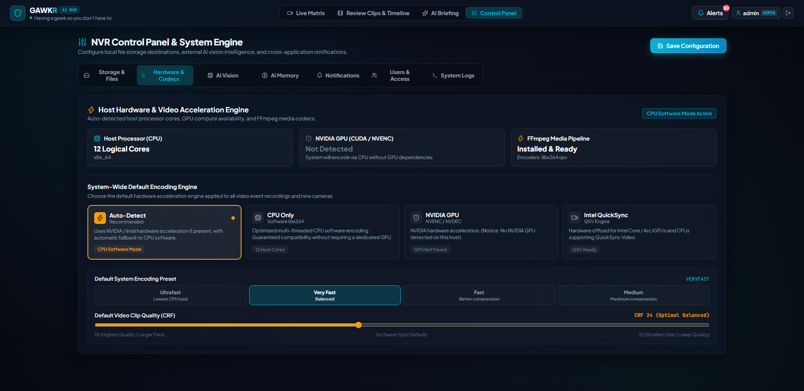

---

### 9. Storage Quotas & Circular Retention Pruning
Primary high-speed NVMe storage and secondary archival tiers with visual usage meters. Set automatic retention windows and safety thresholds (e.g., auto-pruning oldest clips when disk utilization exceeds 90%) to guarantee uninterrupted 24/7 continuous recording.

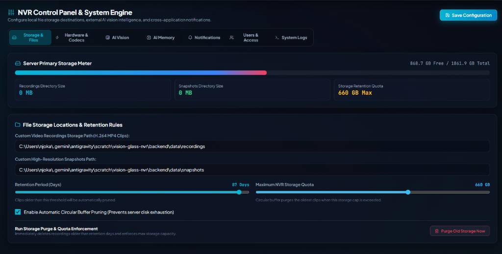

---

### 10. Enterprise Security Audit Trail & Auto-Defense
Track every login attempt, stream access ticket, and administrative action with client IP addresses, geo-headers, and browser signatures. Automatically ban abusive IPs attempting brute-force attacks with instant unban controls.

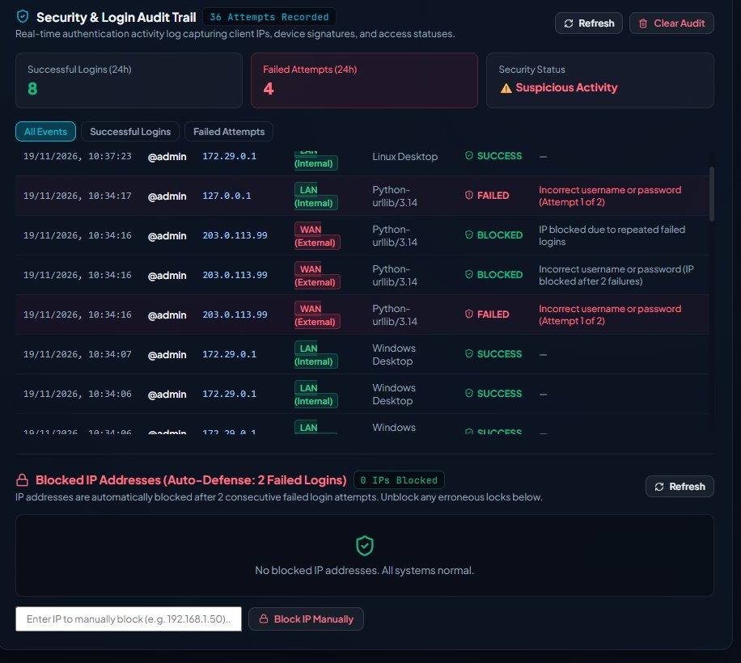

---

### 11. Triple-Protocol Network Camera Discovery
Discover IP cameras on your local network automatically using ONVIF WS-Discovery (UDP 3702), SSDP multicast, and RTSP port probing. 1-click credential verification and profile probing extracts Main and Sub RTSP stream URLs without manual RTSP URL syntax guessing.

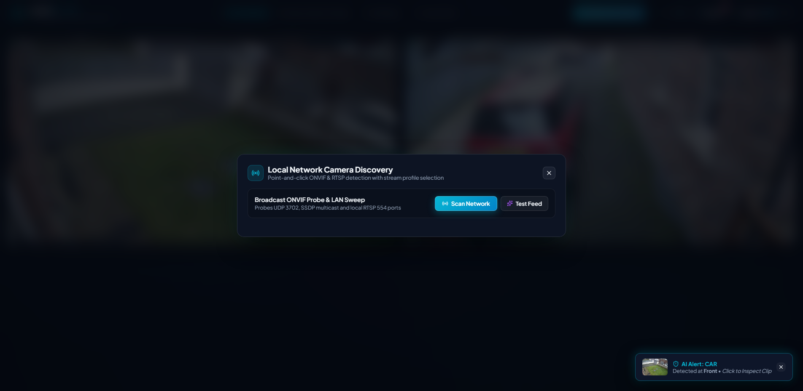

---

### 12. Android Native Companion App
Take your security perimeter everywhere. The native Android companion app streams live dual-feed camera matrices with real-time AI latency badges, an instant sliding notification drawer, and actionable lockscreen push notifications.

<p align="center">
  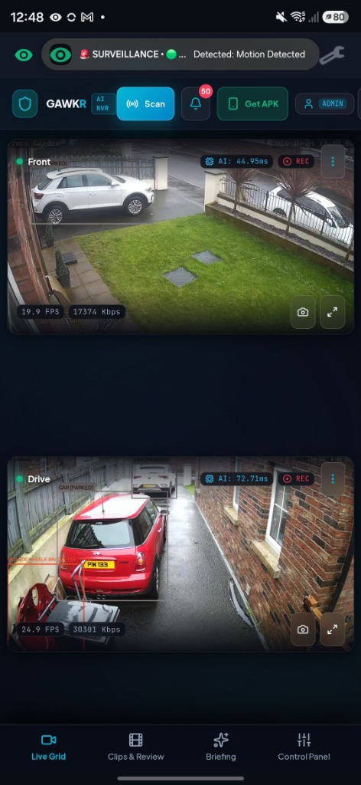
  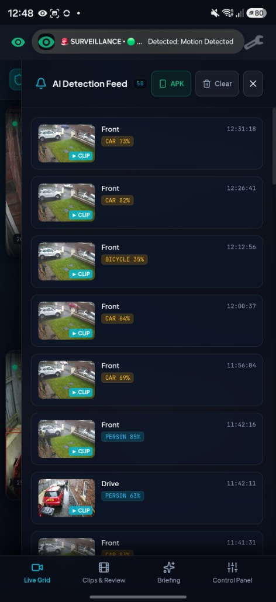
  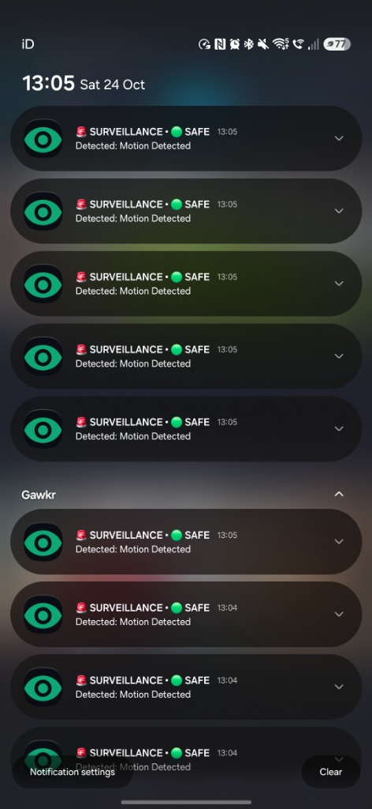
</p>

---

## 🔬 Core Architecture & Features Deep Dive

### 1. Spatial Motion Tracking & Anti-Repetition
Most NVRs flood your phone with notifications every time a leaf twitches or a parked car sits on the driveway. Gawkr solves this with **Spatial Motion Vector Analysis**:
* Identifies static bounding boxes across consecutive frames.
* Computes normalized centroid displacement. Objects that move $< 10\%$ over time are designated `[PARKED]`.
* Mutes outbound alerts for parked entities until they re-engage in active movement or an unrecognized person approaches them.

### 2. "Ask Gawkr" Natural Language Search
Powered by SQLite FTS5 with BM25 ranking:
```sql
SELECT event_id, camera_name, summary, timestamp 
FROM events_fts 
WHERE events_fts MATCH 'courier OR "delivery van" AND front' 
ORDER BY rank;
```
Enables instant search across thousands of recorded clips using conversational phrasing, camera names, entity types, or timestamps.

### 3. Multi-Camera Subject Journey Stitching
When an incident occurs across multiple vantage points, Gawkr correlates timestamps, object classifications, and vector embeddings to reconstruct the chronological path:
```
[11:42:05 AM] Front Gate     → Person detected approaching driveway
[11:42:22 AM] Driveway Cam   → Person inspected parked vehicle [PARKED]
[11:42:48 AM] Porch Cam      → Person left package at front door
```

### 4. Active Perimeter Deterrence & Home Assistant MQTT
Gawkr publishes Home Assistant MQTT auto-discovery topics for every camera:
* `homeassistant/binary_sensor/gawkr_front_motion/config`
* `homeassistant/binary_sensor/gawkr_front_person/config`
* `homeassistant/sensor/gawkr_front_ai_summary/config`

Configure automatic deterrence routines:
- **Dwell Time $\ge 30\text{s}$ in Red Zone**: Publish MQTT event to turn on Philips Hue exterior floodlights at 100% white.
- **Tripwire Breach during Armed Away**: Trigger external siren and broadcast audible voice prompt.

---

## 🚀 Quick Start (Docker Compose)

The easiest way to deploy Gawkr is with Docker Compose:

```yaml
version: '3.8'

services:
  gawkr:
    image: ghcr.io/ihniuk/gawkr:latest
    container_name: gawkr-nvr
    restart: unless-stopped
    ports:
      - "8000:8000"
    volumes:
      - ./data:/app/data
      - ./recordings:/app/recordings
      - ./snapshots:/app/snapshots
    environment:
      - GAWKR_ADMIN_USER=admin
      - GAWKR_ADMIN_PASSWORD=change_this_password
      - GAWKR_SECRET_KEY=generate_a_random_32_byte_secret
      - GAWKR_HWACCEL=auto # auto, nvdec, qsv, or cpu
      - GEMINI_API_KEY=your_gemini_api_key_optional
    deploy:
      resources:
        reservations:
          devices:
            - driver: cdi
              device_ids:
                - nvidia.com/gpu=all
```

Run:
```bash
docker compose up -d
```
Then navigate to `http://localhost:8000` (or `https://cams.ihni.uk`).

---

## 🛠️ Project Structure

```
gawkr/
├── backend/
│   ├── app/
│   │   ├── main.py                     # FastAPI entrypoint, WebSockets & static server
│   │   ├── auth.py                     # RBAC JWT authentication, 2FA/TOTP & stream tickets
│   │   ├── security.py                 # Brute-force IP lockout, Cloudflare header parser
│   │   ├── ai_vision.py                # Multimodal LLM vision & spatial tracking
│   │   ├── search_service.py           # "Ask Gawkr" SQLite FTS5 natural language search
│   │   ├── journey_service.py          # Multi-camera subject journey & incident stitching
│   │   ├── deterrence_service.py       # Active perimeter deterrence & MQTT sentry triggers
│   │   ├── discovery.py                # ONVIF WS-Discovery, SSDP & LAN RTSP probe
│   │   ├── inference.py                # YOLOv8 object detection & polygon filtering
│   │   ├── stream_worker.py            # Dual-stream worker, NVDEC & spatial tracking
│   │   ├── camera_manager.py           # In-memory & SQLite camera management
│   │   ├── storage.py                  # Circular buffer pruning & quota enforcement
│   │   ├── notification_dispatchers.py # Telegram, Discord, Slack, Pushover webhooks
│   │   └── mqtt_client.py              # Home Assistant MQTT auto-discovery client
│   └── requirements.txt
├── frontend/                           # React 18 + Vite Glassmorphic Dashboard
│   ├── src/
│   │   ├── components/                 # LiveMatrix, ZoneEditor, EventDrawer, PlaybackModal
│   │   ├── components/modals/          # SecurityAuditModal, AskGawkrModal, SentryModal
│   │   └── api/                        # REST, WebSocket & Stream API clients
│   └── package.json
├── android/                            # Native Android Companion App
│   ├── app/
│   │   ├── src/main/java/              # Live camera view, WebSocket listeners & push services
│   │   └── res/layout/                 # Dark glassmorphic mobile layouts
│   └── build.gradle
├── docs/
│   └── screenshots/                    # 15 High-resolution application screenshots
└── docker-compose.yml
```

---

## 🔐 Security & Access Control

* **Default Admin**: `admin` / `admin123` *(Prompted to change on first run)*
* **Default Viewer**: `viewer` / `viewer123`
* **Two-Factor Authentication**: Supports Google Authenticator, Bitwarden, 1Password, or any standard TOTP RFC 6238 app.
* **Auto-Defense**: IP lockout occurs after 5 failed login attempts within 5 minutes, with configurable cooldown periods and instant administrative IP whitelisting.

---

## 📄 License

This project is licensed under the MIT License - see the [LICENSE](LICENSE) file for details.
